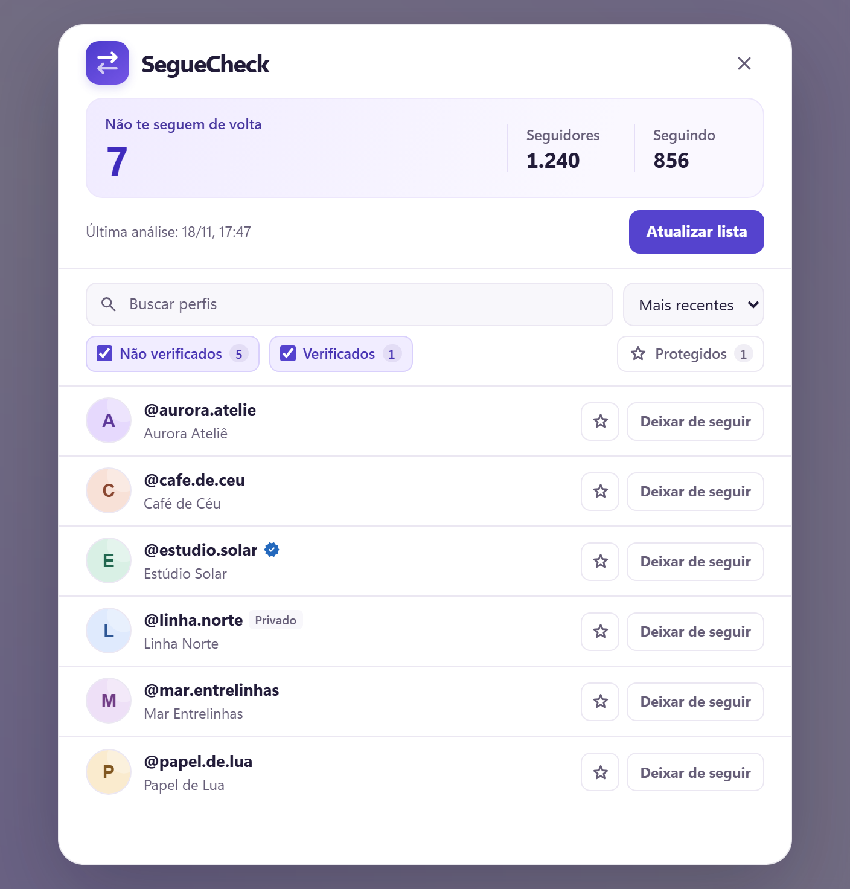

  

<h1 align="center">SegueCheck</h1>

  <strong>Quem você segue que não te segue de volta?</strong> 
  Confira no Instagram com uma extensão para Google Chrome.

  
   
  Captura da extensão com perfis fictícios.

## Experimente no Chrome

1. Baixe ou clone este repositório. Se baixar o ZIP, extraia os arquivos.
2. No Chrome, abra `chrome://extensions` e ative o **Modo do desenvolvedor**.
3. Clique em **Carregar sem compactação** (*Load unpacked*) e selecione a pasta [`seguecheck/`](seguecheck), onde está o `manifest.json`.
4. Com sua conta do Instagram aberta, clique no ícone do **SegueCheck** e selecione **Analisar perfis**.

## Revise sua lista

- **Encontre perfis** pelo nome ou usuário e filtre pelo selo de verificação.
- **Guarde os favoritos** com a estrela para tirá-los da lista principal e revê-los em **Protegidos**.
- **Decida perfil por perfil** se quer continuar seguindo, abrir o perfil no Instagram ou deixar de seguir.
- **Pause e retome** a análise quando precisar.

## Dados e limites

O SegueCheck usa a sessão do Instagram aberta no Chrome para consultar seguidores e perfis seguidos. Preferências, perfis protegidos e resultados recentes são salvos no armazenamento local da extensão.

A análise depende das respostas do Instagram.
